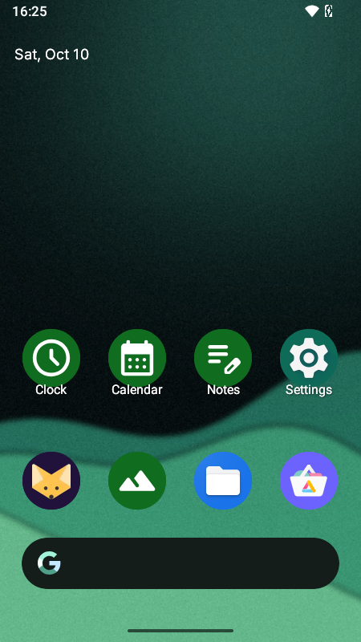

# iDroidik — Android on iPhone 7

Run a real **Android 16** on an **iPhone 7** (iOS 15), on top of the
[Project Sandcastle](https://github.com/corellium/projectsandcastle) Linux kernel.
Not a theme, not an emulator — a real Android desktop with working touchscreen,
Wi-Fi and internet (software-rendered, so usable but not fast). Your iPhone stays a
normal iPhone: iOS boots as usual; Android is loaded from your Mac each time.
Persistent storage (so apps and settings survive reboots) is set up by default during
first-time setup; the Pixel-style launcher is an optional extra step — see below.

> ⚠️ **Status: usable but tethered, and not fully hands-off yet.** It boots to a
> working UI. It has **no audio, camera, cellular, Bluetooth or GPU acceleration**,
> and it must be booted from a Mac each time. See [`docs/STATE.md`](docs/STATE.md)
> for the exact works / doesn't-work list, and [`ROADMAP.md`](ROADMAP.md) for
> what's left before it's a clean, one-command, legal public release.

<p align="center"></p>

Hand-built on real hardware, not a tutorial reskin — the hard-won kernel/boot fixes (why gcc 9
reboots the phone after ~45 s, the cgroup-bpf backport that stops `netd` crash-looping, 16 KB-page
VNDK, capex→apex, the hand-written audio-HAL stub) are written up in
[`docs/TECHNICAL-NOTES.md`](docs/TECHNICAL-NOTES.md). The name **iDroidik** is a nod to the original
iDroid/openiBoot (2010–2012); this is an independent, unrelated project.

## Easiest: set it up with an AI 🤖

Don't want to run commands yourself? Clone the repo, open it in an AI coding agent
(e.g. Claude Code) on your Mac, connect your iPhone 7 **directly** (no USB hub), and
paste the prompt from **[`SETUP-WITH-AI.md`](SETUP-WITH-AI.md)**. The agent installs the
tools, walks you through the DFU button steps, generates the firmware from your own iOS,
and boots Android — you just do the physical bits it asks for.

> Note: the ~3 GB Android image **and the boot binaries** (kernel, initrd, Pongo, vulkan
> driver) are hosted on the `v0.1-exp` GitHub release; `install.sh` fetches them and verifies
> each against a pinned sha256. (To build from source instead, see [`MANIFEST.md`](MANIFEST.md).)

Prefer to do it by hand? Use the quick start below.

## What you need

- An **iPhone 7** (model `iPhone9,3`/`iPhone9,1`) on **iOS 15.x**, checkm8-capable.
  This is destructive-adjacent low-level work — a spare phone is strongly advised.
  **Never restore the phone** (that can wipe it; setup only adds a volume).
- A **Mac** with a USB cable. **Apple Silicon only** in practice — the prebuilt pongo loaders
  (`loader/pongo-*`) are arm64 and link against Homebrew `libusb`; an Intel Mac would need them rebuilt.
  (The x86_64 binaries in `android-sandcastle/` are the original Sandcastle macOS tooling, used only
  by the legacy helper scripts `boot.sh`, `wait-and-load.sh` and `boot-android-shell.sh` — not by
  `android.sh`; on Apple Silicon they need Rosetta.)
- **macOS only.** Windows is not supported (palera1n has no Windows build); Linux hosts would need the loaders rebuilt and the scripts ported.
- Tools: `install.sh` auto-installs [`palera1n`](https://palera.in), `sshpass`, `adb` and
  `libusb` (`sshpass`/`adb`/`libusb` via [Homebrew](https://brew.sh));
  [`colima`](https://github.com/abiosoft/colima) is only needed if you build from source.

## Quick start

**Prerequisite (one-time):** your iPhone 7 must be on **rootful** jailbroken iOS 15 with
**OpenSSH** running (root password `alpine` by default — see [Security](#security--read-this)) and reachable over SSH — set that up with
[palera1n](https://palera.in) (rootful; the first run creates the fakefs and installs the
bootstrap/SSH). Everything below drives the phone over that SSH connection, so confirm
`ssh root@<iPhone>` works before running `setup-device.sh`.

> Free space: the rootful **fakefs**, the ~3 GB Android image and the ~6 GB persistent
> `userdata.img` all share the iPhone's single APFS container with iOS. Keep **~10 GB+ free in
> iOS** (setup refuses to overflow it; with less, persistence falls back to a RAM `/data`).

```bash
git clone https://github.com/Aisamo-fi/iDroidik.git && cd iDroidik
cp config.env.example config.env      # set IOS_IP (your jailbroken iPhone's SSH IP)
./install.sh                          # auto-installs palera1n + sshpass + adb; fetches & verifies image + boot blobs
./setup-device.sh                     # FIRST TIME ONLY: create the Android volume + firmware
./android.sh                          # exploit → boot Android (follow the DFU prompts)
./tools/fetch-apks.sh                 # download the FOSS apps (Lawnchair, Lawnicons, F-Droid…)
./pixelify.sh                         # make it look/act like Pixel + install those apps
```

- `./setup-device.sh` is the one-time, **experimental** first-time bring-up (creates the
  "Android" APFS volume on the phone, copies the firmware-free image, and generates the
  touch + Wi-Fi firmware from your own iOS). After it, just use `./android.sh` to boot.
- The shipped image is **plain Android (GSI)** — the Pixel look and apps are **not** baked in.
  `./tools/fetch-apks.sh` + `./pixelify.sh` reproduce the Pixel-style setup (Lawnchair + Lawnicons,
  dark mode, circle icons, wallpaper) and install the FOSS apps. Proprietary apps (TikTok, etc.)
  you install yourself from Aurora Store afterwards. (Your personal data is never shipped.)
- **Not shipped in git** (fetched instead): the ~3 GB Android image **and the boot binaries**
  (kernel, initrd, Pongo, vulkan driver). `install.sh` auto-fetches all of them from the
  `v0.1-exp` GitHub release and verifies each against a pinned sha256; if anything is missing or
  a checksum fails it stops and says so. (To build from source instead, see
  [`MANIFEST.md`](MANIFEST.md) / [`docs/BUILD.md`](docs/BUILD.md).)
- Apple firmware is **never redistributed** — it is generated on your device from your own
  iOS (see [`docs/FIRMWARE-AND-LEGAL.md`](docs/FIRMWARE-AND-LEGAL.md)).

## `android.sh` commands

| Command | What it does |
|---------|--------------|
| `./android.sh` | boot Android and apply performance/thermal tuning (default) |
| `./android.sh deploy` | write a rebuilt image to the phone, then boot it |
| `./android.sh save` | copy Android `/data` back to the Mac |
| `./android.sh restore` | restore saved `/data` into a running Android |
| `./android.sh tune` | re-apply tuning to a running Android |
| `./android.sh linux` | boot the Sandcastle **Linux** build instead |

> ⚠️ After `./android.sh deploy`, the phone is left set to stay in **Recovery** between boots
> (needed for the tethered Android boot). That is normal — to go back to normal iOS run
> `~/.local/bin/palera1n -n`. **Do not** "Restore" the phone in Finder (that erases it).

## Security — read this

This is a **development build**, not a hardened phone. While you use it:

- **iOS side:** setup needs jailbroken iOS with SSH as `root`, and the default password is the
  well-known `alpine`. Anyone on the same network can log in as root. **Change it** on the phone
  (`passwd`) and put the new one in `config.env` (`IOS_SSH_PASS`), or keep the phone off shared
  Wi-Fi while jailbroken.
- **Android side:** SELinux is **permissive** and `adb` runs as **root**. `./android.sh save`
  switches ADB to listen on **TCP port 5555** over Wi-Fi (for the bulk transfer) and it stays open
  until Android reboots — anyone on the same network could get a root shell. Only run it on a
  network you trust, and reboot Android afterwards.
- **Never use it on public / café / office Wi-Fi**, and don't sign into accounts you care about
  on the Android side.

## How it works (short version)

checkm8 (via palera1n) → PongoOS → Sandcastle Linux 5.4 kernel → Android 16 GSI.
The Android partitions live in a `nand` image file on a dedicated APFS volume inside
the iPhone. Full details in [`docs/ARCHITECTURE.md`](docs/ARCHITECTURE.md).

## Legality

This project **never distributes Apple firmware**. The touch/Wi-Fi/Bluetooth
firmware is extracted on *your* device from *your* iOS, the way Project Sandcastle
does it. See [`docs/FIRMWARE-AND-LEGAL.md`](docs/FIRMWARE-AND-LEGAL.md). Everything
original here is MIT ([`LICENSE`](LICENSE)); third-party components keep their own
licenses ([`NOTICE`](NOTICE)).

## Documentation

- [`docs/STATE.md`](docs/STATE.md) — what works / what doesn't, and hard constraints
- [`docs/ARCHITECTURE.md`](docs/ARCHITECTURE.md) — the boot chain and image layout
- [`docs/TECHNICAL-NOTES.md`](docs/TECHNICAL-NOTES.md) — the non-obvious fixes
- [`docs/BUILD.md`](docs/BUILD.md) — building the kernel / loaders / GPU driver
- [`docs/FIRMWARE-AND-LEGAL.md`](docs/FIRMWARE-AND-LEGAL.md) — firmware & legality
- [`MANIFEST.md`](MANIFEST.md) — where the large binaries come from
- [`ROADMAP.md`](ROADMAP.md) — prioritized open tasks
- [`AGENTS.md`](AGENTS.md) — orientation for an AI agent (or human) continuing this

## Continuing development

This project is set up to be picked up by an AI coding agent as much as by a human.
If that's you (or your agent), start with **[`AGENTS.md`](AGENTS.md)**, then
`docs/STATE.md` and `ROADMAP.md`.

## Credits

Built on Project Sandcastle (Corellium), PongoOS (checkra1n), palera1n, SwiftShader
(Google), and TrebleDroid / AOSP. See [`NOTICE`](NOTICE).
